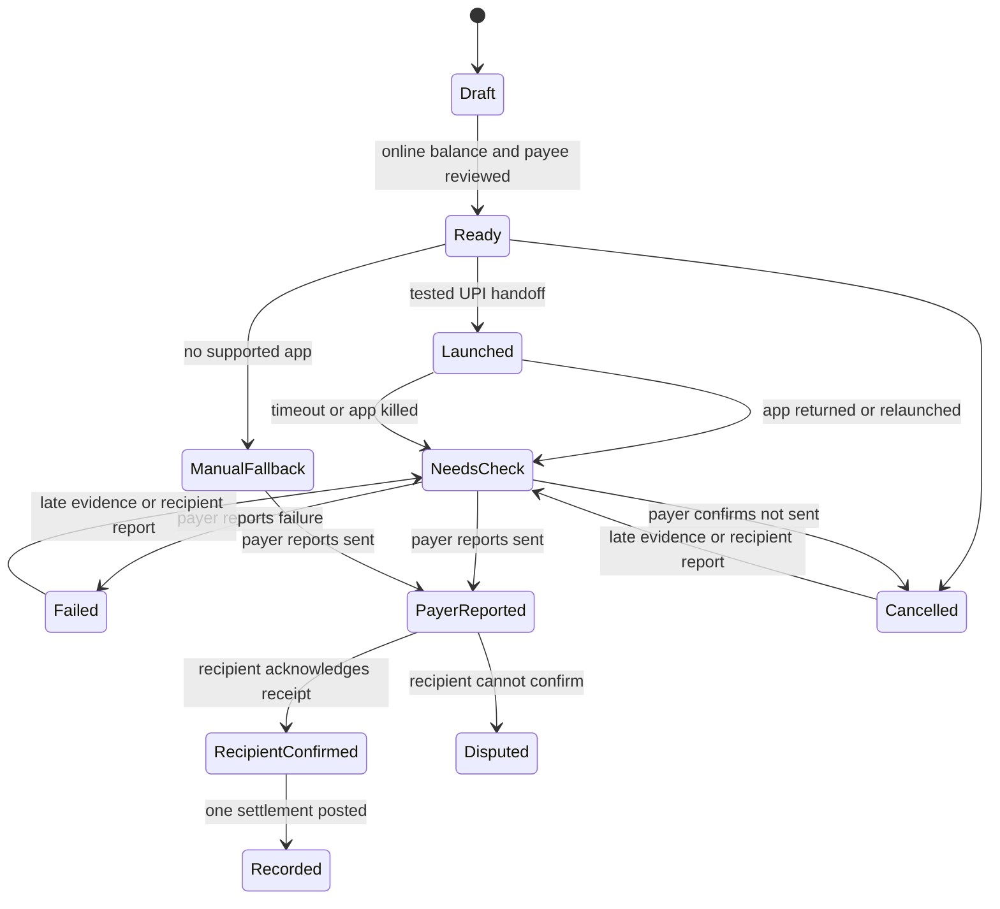
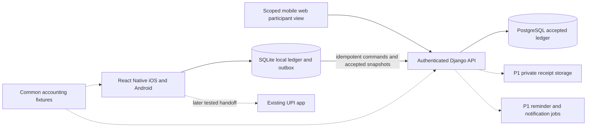

# MeroSplit product requirements

Product requirements, 16 October 2026. Public app name: MeroSplit. Product owner: Om Shejul. Platforms: iOS and Android. Implementation is now authorized. The current build uses Django/PostgreSQL and Expo React Native, with the selected mint group-first design and library-backed native controls. [Design decisions](.dev/merosplit-design-decisions.md) record the input, navigation and simplicity choices. [PLAN.md](PLAN.md) records implementation phases and their abstraction checks. The original P0/P1/P2 tables remain the research sequence; current implementation details below and in the API contract take precedence where later authorized work shipped earlier items such as media, import and notifications.

This document describes the target product. The latest implementation adds one Expo interface for native and full web use, four-digit email-code sign-in through existing allauth identities, explicit optional email invitations in two-person People ledgers, and guarded UPI app handoff. Merely opening a payment app never posts or verifies a payment. Manual share-link claims still require organizer approval; email-bound claims require the intended verified address. Historical acceptance reports describe their tested versions. Current native/browser, live inbox and physical installer evidence must be recorded separately before release. New clients load50-row history pages with complete server-computed balances and totals; same-version refresh avoids redundant downloads. Legacy complete snapshots remain for older clients and explicit recovery/export. No maximum-capacity or real bank-payment claim is made. See [API contract](API_CONTRACT.md) for current operations and [phase reviews](.dev/PHASE_REVIEWS.md) for implementation and abstraction checks.


Build an India-first shared-expense app for friends on trips and people sharing a home. A person should be able to record a bill without an interruption, explain every share, and help a friend repay through their existing UPI app. The group must still work when some participants have not installed the app.

The recommendation is to prototype this narrower product before funding a full Splitwise replacement. UPI is useful but already appears in competitors and payment-app substitutes. The stronger reason to switch is the combination of fast entry, low-friction participation, an explainable ledger, careful migration and honest repayment status. Retention and willingness to pay remain unproven.

## 1. Evidence and boundaries

Use [Splitwise behavior](research/SPLITWISE_FEATURES.md), [India user research](research/INDIA_USER_RESEARCH.md), [market assessment](research/MARKET_RESEARCH.md), [UPI and architecture](research/UPI_AND_ARCHITECTURE.md), and [test coverage](research/HANDS_ON_TEST_LOG.md) as supporting evidence. Requirements below are proposed behavior unless explicitly attributed to Splitwise.

The current Splitwise help documents four free expenses per day. Annual Individual and Duo subscriptions include one Trip Pass that grants a chosen group Pro features for 30 days. Old complaints about different limits or the absence of any group trip plan must not become current product claims. [Splitwise Pro help](https://kb.splitwise.com/pro/what-is-splitwise-pro)

Current India payment availability is unresolved. The India store listing advertises Paytm, but current payment help describes the US and select European countries. Neither proves a working generic UPI flow on an Indian iPhone today. The Android test flow showed only manual payment recording for a synthetic recipient without a phone or VPA, in an account initially defaulting to USD. That observation does not establish India-wide availability. [India listing](https://apps.apple.com/in/app/splitwise/id458023433), [payment help](https://kb.splitwise.com/payment-integrations/how-do-i-send-money-to-someone-on-splitwise)

The research collected 1,500 review IDs across three Apple storefronts. Research agents manually inspected 100 latest negative or mixed India-store reviews and 30 latest positive-star India-store reviews. These are selected review samples, not estimates of Indian market prevalence. See the [audit](research/results/apple_review_audit_summary.json). A follow-up walkthrough tested Splitwise Android 26.9.1/963 in an official Google Play emulator. Four synthetic bills and one manual payment verified a simplified debt chain, partial repayment, equal rounding and multiple payers. The fifth expense was blocked. See the [native findings](research/ANDROID_HANDS_ON_FINDINGS.md) and [transcribed fixture](research/results/native_accounting_fixture.json). iOS, real UPI, offline conflicts and actual exports remain untested; the [test log](research/HANDS_ON_TEST_LOG.md) tracks those gaps.

Implement shared-expense concepts independently. Do not copy Splitwise code, branding, screenshots or private interfaces into the product. Do not depend on Splitwise's developer API for competitive replication. Its API terms restrict that use. User-supplied exports need a separate compatibility and rights review. [Developer terms](https://dev.splitwise.com/)

## 2. Who uses it

| Segment | Trigger and job | Existing workaround | Product priority |
|---|---|---|---|
| Domestic trip organizer, 3–12 friends | Record a backlog of bills and settle the trip fairly | Splitwise, WhatsApp, calculator, Sheet | First acquisition and pilot segment |
| Flatmates, 2–6 people | Track groceries, utilities and shared supplies over months | Splitwise, payment-app requests, Sheet | Second retention segment |
| Couples with unequal contributions | Maintain an agreed ratio and understand spending | Splitwise default splits, shared Sheet | Reuse percentage and shares support; validate separately |
| Colleagues or occasional diners | Split one bill without requiring another account from everyone | Google Pay, BHIM, Paytm, mental arithmetic | Guest access helps; do not assume a standalone app is better |

The organizer chooses the tool, but the product fails if other participants cannot understand or trust the result. The organizer may eventually buy an optional plan for a group. Recipients should not need a paid plan to inspect or acknowledge a balance.

## 3. Product promises

1. Save ordinary expenses without daily entry caps, countdowns, video ads or a trial blocking the form.
2. Show who paid, who benefited, how rounding worked, and why a balance changed.
3. Preserve a usable local ledger when the network disappears. Clearly distinguish pending local changes from accepted group records.
4. Let an organizer use guest names immediately and let invited people review their own shares through a secure link.
5. Offer UPI-assisted repayment only where actual device tests establish support. Always provide a truthful fallback.
6. Preserve a portable record and change history. Do not silently rewrite historical splits or payment evidence.

These are launch requirements, not a promise of free unlimited cloud services forever. Publish tested size limits and any future service limits before users depend on them. Reading records, exporting and deleting an account remain available after a paid plan ends.

## 4. Scope and sequence

### P0 controlled pilot

| ID | Requirement | Done when |
|---|---|---|
| P0-01 | iOS and Android application in React Native with Expo development builds | Same accounting fixtures pass on both; native journeys exercised |
| P0-02 | Local solo use, account for shared collaboration | Organizer can create a local group before login; publishing explains who receives its data |
| P0-03 | Trip, household and private two-person ledgers | Groups retain their own members, events and balances; two-person ledger is a constrained group |
| P0-04 | Name-only guests, revocable invite links and explicit guest claiming | No contacts access required; duplicate-looking names never auto-merge |
| P0-05 | Equal, exact, percentage and shares splits, selected beneficiaries and multiple payers | Allocations and contributions always reconcile to the total |
| P0-06 | INR expenses and manual INR repayments | Store integer paise and show Indian number grouping; unsupported currencies are rejected clearly |
| P0-07 | Notes, category and expense date | Save a complete bill without media; comments and receipt uploads are P1 |
| P0-08 | Group totals, person balances, basic search and explanation | Search and paid/share/net totals remain available without purchase |
| P0-09 | Simplify debts, required in the first release | Cancel circular debts and suggest fewer repayments within a group while preserving each person's net balance; preview, explain and pay the proposed amounts |
| P0-10 | Cash/manual bookkeeping settlements, UPI-assisted attempts and recipient acknowledgment | Opening an external app never posts a successful payment |
| P0-11 | Offline create/read, durable outbox, explicit edit conflicts and audit history | Relaunch and retry do not create duplicates or lose accepted records |
| P0-12 | CSV and documented JSON ledger export | Accepted and pending records are distinguished; full backup/restore is P1 |
| P0-13 | Acknowledged opening-balance migration | All participant opening balances sum to zero and source/cutoff are recorded |
| P0-14 | Restricted CSV migration feasibility experiment | Local research prototype only; public history import remains P1 until independent source balances reconcile |
| P0-15 | In-app activity and user-initiated reminder sharing | User reviews current accepted amount and chooses destination; automated reminders and push are P1 |
| P0-16 | Accessible entry, clear errors, account export/deletion, support | VoiceOver/TalkBack can complete the core flows; privacy tests pass |

Proposed capacity targets, pending performance measurement: 100 participants per group, 10,000 accepted ledger events per group and 100 groups in the active local catalog. The current implementation enforces 100 participants, ₹1,00,00,000.00 per bill/payment, and a 10,000-expense-row insertion guard that includes deleted expenses. That row guard does not cap revisions, settlements, payment attempts or activity, and the 100-group catalog target is not enforced. No test establishes the proposed maximum-capacity performance envelope yet. Publish measured limits before a broader pilot. Receipt uploads are excluded from P0; the P1 attachment proposal is one image up to 5 MB per expense. Do not market unlimited storage. Capacity increases require performance and cost evidence.

### P1 public beta after the accounting and collaboration pilot

Receipt uploads and comments, complete backup/restore, fixture-tested history import, optional push, formal trip closure, recurring rent/utilities, saved default splits, explicit adjustments, restaurant itemization with quantity weights, tax/tip allocation, refunds linked to the original purchase, multiple currencies with separate balances, manual FX rates, and richer reports. An authoritative direct-debt mode needs its own settlement-allocation design and tests before inclusion. Design these now but add them after P0 reliability. See sections 9 and 16.

### P2 only after validation

OCR-assisted itemization, Hindi interface and additional languages, automated reminder schedules, paid cloud attachment capacity, more export formats and provider-backed verified payment status if a suitable P2P partnership exists.

No wallet, stored funds, bank-login aggregation, UPI PIN capture, credit, debt collection, merchant settlement business, automatic reading of all SMS/WhatsApp messages, or lending. No payment gateway inserted between friends merely to obtain a webhook. The functional implementation is authorized; paid features and store submission remain outside this build.

## 5. Primary user journeys

The tested Splitwise Android member form required an email or phone; contacts permission was optional. Our name-only native entry is a proposed convenience improvement, not proof that Splitwise has no guest participation elsewhere. Its documented web name-only flow and other competitors must be considered.

### Start a trip

Open app → Create group → enter name → add people by name → add first expense. Default currency is INR and the creator is selected as payer. Do not ask for contacts, notifications, email verification or a subscription before local first value.

To collaborate, the organizer signs in and publishes the group. Explain that names, expenses and balances will become visible to authorized members. Generate individual invitation links when practical, with expiry, revocation and an explicit recipient. A broad group invite requests membership approval; it does not expose the entire ledger to anyone who forwards it.

### Add a bill

Select group → enter amount and description → confirm payer and beneficiaries → Save. Equal split is the default, using the group's selected active members. Changing membership later does not alter an existing expense. People lists two-person ledgers and separately named people in their shared groups. A group net balance is not presented as a bilateral amount owed to every member. Date defaults to the current local date. A private draft survives navigation and restart, until explicit sign-out removes account-local data.

Advanced split modes open one sheet with a live total, remaining difference and preview. Multiple payer amounts have their own reconciliation row. The save action says exactly why it is disabled, such as "₹20 is unassigned." Network loss produces "Saved on this phone. Waiting to sync." An accepted record shows the server's revision in Details, not a technical identifier in the primary list.

### Review what is owed

Open group → see "You paid", "Your share" and "Your balance" → tap a person → inspect the contributing bills and repayments. Group total is gross purchases, not the sum of debts. A cash repayment is not additional spending. The activity feed shows edits, deletion/restoration, member changes and payment confirmations separately.

### Repay through UPI

Open balances → choose recipient → review current amount and the recipient's saved UPI address → choose an installed supported payment app. Recheck the accepted ledger version, payee version and prior open attempts immediately before launch. A newly changed amount or UPI address requires a fresh review.

The external UPI app controls authentication and bank transfer. On return, show "Confirm the result" with "I paid", "Payment failed" and "I will check." A payer report requests recipient acknowledgment. It does not become bank-verified. If the handoff is unsupported, show QR on a second device, share/copy payment details, and explain the manual confirmation step. Sharing requires the user to choose a destination through the system share sheet.

### Participate without installing

An invited participant opens a secure HTTPS link, sees the sender and group name, accepts the invitation, and reviews the relevant ledger. An invitation token alone permits only a scoped read view. Posting a receipt acknowledgment requires sign-in to the recipient's linked account and an approved participant claim. Sign-in verifies mailbox ownership with a short-lived four-digit code. A manual invitation still requires organizer approval; an email-bound invitation grants access only to that exact verified address. Neither route proves a real-world identity. A person without an approved claim can ask the organizer to record a manual payment; they cannot create a recipient-confirmed settlement. No guest can change another person's UPI address or publish arbitrary bills. Name-only entries remain unclaimed until an explicit linking flow is accepted.

The web app is a full product entry point. It shares Expo screens, domain logic and the canonical backend with native clients. Recipients can sign in, join their ledger and manage bills in a browser without installing an app. Platform adapters handle cookies/CSRF, SQLite, files, exports and payment links.

### Leave, archive or close a group

Archiving hides a settled group from the default list without removing records. A departed participant remains referenced by historical events. Leaving with a balance warns clearly and preserves access to the person's relevant history. Zero balance does not erase expenses. P0 closeout means reviewing current balances, exporting and archiving. P1 formal closure creates a dated report, blocks new edits until an explicit reopen event, and records participant acknowledgments when collected.

## 6. Navigation and interface

Use three main destinations: Groups, People and Me. Choose a group before adding a bill or recording a payment. Group detail opens Bills, Who owes? and Totals. Group settings contains members, invitation claims, previous balances, export and archive. Me contains sign-in, the person's UPI address, Sync settings, History and Your data. Account options live inside Your data. Private phone data and shared account data have an explicit scope selector. P1 adds supported history import, Create backup and Restore backup.

Use the selected mint design, React Native Paper controls and native calendar pickers. Amount and description are the first bill inputs; payer, split, date and notes open only when needed. Checkboxes select multiple people, radios select one split method, and previous balances use Owes / Is owed with positive decimal input. Freeform fields remain for names, descriptions, notes and payment addresses. Keep each primary action clear and remove controls that add no decision.

Expense Details contains payer contributions, beneficiary shares, split explanation, date, category, notes and revision history. P1 adds images and comments. Edit, delete and restore actions operate on that expense. Preserve list scroll and search context when returning from details.

Keep ordinary rows flat and readable. Use light surfaces, dark text and the selected mint accent. Red means an error or destructive action; debt direction also has words and signs. Use semibold as the highest text weight. The current pilot uses a light appearance. Dark appearance and its manual preference remain later work; preserve native text scaling and reduced motion behavior.

UI copy must distinguish these states: "You owe ₹400", "₹400 payment awaiting confirmation", "₹400 recorded manually", "Receipt confirmed by Asha", and, only with trusted provider evidence, "Payment verified." Do not show "All paid" because an external app opened.

## 7. Accounting model

The following is our specification, not a claim about Splitwise's private algorithm. Each ledger has a currency. Every amount uses integer minor units, with BigInt arithmetic inside the shared engine and strict bounded integer parsers at input boundaries. Never multiply money and weights through floating-point Number arithmetic. No raw BigInt crosses JSON. INR has 100 paise per rupee. The API sends money integers as decimal strings; it never sends JavaScript floating-point currency values.

For an expense of total T and participant i:

```text
paid[i]  = participant's actual contribution to this purchase
share[i] = participant's allocated consumption/cost
sum(paid) = T
sum(share) = T
delta[i] = paid[i] - share[i]
sum(delta) = 0
```

Positive net balance means the participant is owed money. Negative means they owe. Accepted ledger events determine the shared balance. Unsynced changes create a separate local projection with a visible pending status.

For a repayment of x from debtor D to creditor C:

```text
delta[D] += x
delta[C] -= x
```

A repayment does not create a new restaurant or travel expense. For new payment initiation, a proposed Pay with UPI amount is limited to the current payable, with a partial-payment option. Explicit past-payment bookkeeping can record an overpayment after a warning. A real received transfer must always be recorded at its actual amount, including when a stale quote creates an overpayment and reverse credit.

### Split rules

| Mode | Input and validation | Allocation |
|---|---|---|
| Equal | Nonempty selected beneficiaries | Equal rational weights; largest remainder distributes spare paise |
| Exact | Nonnegative paise per beneficiary; sum equals T | Preserve exact entries; no hidden adjustment |
| Percentage | Up to two decimal places, sum exactly 100.00% | Represent basis points as integers; apply largest remainder |
| Shares | Nonnegative weights, up to four decimal places; at least one positive weight | Convert decimal weights to common integer scale and normalize |
| Multiple payers | One or more nonnegative contributions; sum equals T | Contributions independent from beneficiary shares |

Allocate floor(T × weight / totalWeight) to each person, then distribute the remaining paise in descending fractional-remainder order. Resolve ties using immutable participant IDs and save the resulting allocations with the expense. Renaming or reordering people cannot move a paise. Show any rounding adjustment in the preview. Do not recalculate accepted old splits when software changes.

Zero share is allowed for an excluded participant but must not accidentally select them as a beneficiary. A payer can be excluded from consumption. Reject empty allocations, invalid decimal input, negative standard bills, NaN, overflow and mixed currencies. A zero-total draft may be kept but cannot post a purchase event. P1 refunds have a separate type and validation rules.

### Worked examples and golden fixtures

| Scenario | Expected result |
|---|---|
| Asha pays ₹1,200 for Asha, Bharat and Charu equally | Shares ₹400 each. Nets Asha +₹800, Bharat −₹400, Charu −₹400 |
| Asha pays ₹900, Bharat ₹300, total ₹1,200, equal thirds | Asha +₹500, Bharat −₹100, Charu −₹400. A payer can still owe money |
| ₹100 between three people equally | ₹33.34, ₹33.33, ₹33.33 according to persisted tie order; no missing paise |
| ₹1,000, percentages 50%, 30%, 20% | ₹500, ₹300, ₹200 |
| ₹1,200, shares 2:1:1 | ₹600, ₹300, ₹300 |
| Asha pays ₹900, only Bharat and Charu benefit | Asha +₹900; each beneficiary −₹450 |
| ₹1,000 exact shares entered as ₹600 and ₹350 | Reject with ₹50 unassigned; no save |
| Bharat owes Asha ₹400 and repays ₹150 | Bharat still owes ₹250, Asha credit reduces by ₹150; spending unchanged |
| Repeat submission of the same expense command after network timeout | One expense revision and one ledger effect |
| Asha owed Bharat ₹500 in one group and Bharat owed Charu ₹500 in another | Keep group obligations separate; do not route Asha to Charu across groups |

The table specifies our proposed implementation. Separate [native fixtures](research/results/native_accounting_fixture.json) transcribe observed Splitwise cases; their final balances were independently reconciled in integer paise. The observed extra paise went to A, but this does not establish Splitwise's private tie-break rule. Run our specified deterministic rules on both server and mobile when implementation starts.

## 8. Simplify debts, required in the first release

Simplify debts is a core P0 feature. It must ship with the initial iOS and Android pilot. In the native Splitwise test, enabling Simplify changed A owing B ₹500 into A owing C ₹500 after the chain A → B → C. Recording ₹200 to C left ₹300 owed. Original bills remained visible. The calculation below specifies our implementation; it is not a claim about Splitwise's private algorithm.

### Controls and explanation

Group → Balances → Simplify debts opens a repayment preview. Show each proposed sender, recipient and exact amount, with a short explanation of any changed recipient. Provide "Why this payment?", a user-triggered share action and "Pay with UPI" or "Record a payment" for an eligible transfer. All participants can inspect the plan without buying a subscription. A participant can still record the actual payment they made to another member; the next proposal recalculates from that recorded transfer.

Opening or sharing the preview has no ledger effect. Recalculate after accepted bills, edits, deletions and recorded repayments. Bind payment attempts to the reviewed plan version, and require a new review if the amount or recipient changes. Preserve in-flight attempts and suppress duplicate payment suggestions as specified in section 10.

### Calculation and preserved history

P0 preserves each purchase's original payer contributions and beneficiary shares, then calculates the outstanding repayment proposal from current group net balances. It does not keep a second authoritative table of pair debts or offer a direct-debt toggle. This avoids stale original debts after a rerouted payment. Expense Details still explains who originally paid for whom.

Match a largest debtor to a largest creditor, transfer the smaller absolute amount and repeat until all nets are zero. Use stable IDs for ties. This greedy method produces at most n−1 transfers among n nonzero participants. Do not claim that it always minimizes the number of transfers. The plan is a proposal, not an assertion that these people originally exchanged money.

Example in one group: Asha owes Bharat ₹500 and Bharat owes Charu ₹500. Nets are Asha −₹500, Bharat ₹0 and Charu +₹500. The proposal is Asha → Charu ₹500. Once that receipt is recorded, all current nets are zero. The original purchases remain visible, but no screen continues to request Asha → Bharat or Bharat → Charu. This exact scenario is a required regression fixture.

Never combine currencies or cross group boundaries automatically. A confirmed settlement records actual sender, receiver, amount, source and originating plan version. Pending payment attempts survive later plan changes and receive an explicit in-flight display. Net-only historical imports are labeled as such; original payer/share detail is unavailable.

If later users need a direct-debt mode, first specify how non-direct transfers allocate or rewrite outstanding obligations, including disconnected original debt graphs, partial repayments and cycles. Defer that mode until its invariants and UI explanations pass tests. Do not add a toggle over unadjusted historical edges.

### Required simplification cases

| ID | Starting situation | Expected result |
|---|---|---|
| SD-01 | Asha owes Bharat ₹500; Bharat owes Charu ₹500 | Propose one payment, Asha → Charu ₹500. Bharat pays and receives nothing |
| SD-02 | Asha owes Bharat ₹300; Bharat owes Charu ₹300; Charu owes Asha ₹300 | All net balances are zero, so no repayment is needed |
| SD-03 | Asha is owed ₹700, Bharat ₹100; Charu owes ₹500, Deepa ₹300 | Propose Charu → Asha ₹500, Deepa → Asha ₹200, Deepa → Bharat ₹100 |
| SD-04 | After SD-01, Asha's ₹200 payment to Charu is recorded | Propose only the remaining Asha → Charu ₹300 |
| SD-05 | After SD-01 is fully settled, edit the original Asha → Bharat obligation to ₹600 | New balances are Asha −₹100, Bharat +₹100, Charu ₹0; propose Asha → Bharat ₹100 |
| SD-06 | SD-01 has a ₹500 payer report awaiting Charu's confirmation | Keep the accepted balance and pending report distinct; show the existing attempt rather than another default ₹500 Pay action |
| SD-07 | A chain spans separate groups, or separate currencies in a later release | Keep those ledgers separate; no automatic cross-group or cross-currency offset |
| SD-08 | Equal balances, paise remainders, member renaming and repeated calculation | Stable participant IDs produce deterministic proposals; total paid equals total received and every participant's final net is zero |

For every proposal, verify that the implied repayment postings would zero all current group balances. Expenses, beneficiary allocations, group spending totals and historical receipts remain unchanged. Tests must also cover a payment to a different recipient than proposed, followed by recalculation.

## 9. Later accounting requirements

### Itemization

Represent item quantity, unit/line price and allocations. One person can consume two of three units. Allocate tax and service charge only to their declared bases, with explicit choices for discounts and tips. The selected line totals, adjustments and tax must reconcile to the receipt total. Dietary or alcohol exclusions require item selection, not an inferred personal profile. OCR creates an editable draft and never commits an unreviewed ledger event.

### Recurrence

Store an explicit rule, timezone, next occurrence date and beneficiary snapshot policy. A server job creates one occurrence per schedule/date key. Month-end rules define what happens to the 29th–31st. Pausing and editing future occurrences do not rewrite the past. Offline clients do not independently post recurring duplicates. No bank autopay is implied.

### Refunds

A refund references an earlier purchase and an explicit receiver of the returned money. Allocate credited shares to the original or deliberately chosen beneficiaries. Reverse the corresponding financial effect, not a bank transfer. A refund after settlement may create a new amount owed. Prevent total linked refunds exceeding the original unless a documented adjustment explains it.

### Foreign currency

Keep balances separate by currency. Never add ₹500 and US$10 into one payable number without an explicit conversion event. Future conversions preserve original amounts, source, rate, effective date, rounding and resulting allocations. UPI assistance is for INR payable amounts only. A cosmetic approximate total must be labeled and cannot drive settlement.

## 10. UPI requirements and payment states

The product is an expense ledger with payment assistance. A URL scheme or QR is not a banking status API. Merchant provider guides do not automatically authorize or verify arbitrary P2P transfers. Google's official iOS flow requires a manual return to the originating app, and its Android guidance requires PSP verification rather than trusting client success text. [Google Pay iOS](https://developers.google.com/pay/india/api/ios/in-app-payments), [Android guidance](https://developers.google.com/pay/india/api/android/in-app-payments)

### Payee setup

Only the account holder edits their UPI address. Organizer-entered guest addresses are explicitly unverified, require the recipient's acknowledgment before a guided payment, and never merge identities. Store VPA and display name privately, version changes and alert affected users on a change. Format validation establishes syntax only. Do not label a typed name as a bank-verified beneficiary. The bank app remains the final name check.

Before opening an app, display recipient, address, INR amount and note. Encode values safely and use a tested allowlist of schemes/providers. Generate references on our server. Do not accept arbitrary external URLs as payment destinations. Never collect a PIN, OTP or bank password.

### State machine



Manual bookkeeping is a separate path: an authorized member explicitly records a past cash/bank payment with sender, recipient, amount, date, source and recorder. It posts with a "Recorded manually" label and an audit entry. It must not masquerade as a verified UPI transfer. If the transfer already has an attempt, atomically link and close that attempt when posting the manual record. A unique linked-attempt constraint prevents later recipient acknowledgment from posting the transfer again; acknowledgment appends receiver evidence without another ledger effect. Retain the original manual source, recorder and posting date; the display can say "Recorded manually; receipt confirmed by Bharat." For payments recorded with no attempt, warn about similar records and provide a reviewed link/merge correction, without assuming equal amounts mean the same bank transfer.

Only recipient confirmation, an explicit manual bookkeeping command, or a future trusted provider verification may post a settlement. Distinguish these sources permanently. A receipt image, typed reference or successful-looking callback is supporting information, not proof. The initial partner-free design has no "Bank verified" state available to users.

### Concurrency and duplicate payment protection

Persist the attempt before launch with an idempotency key, sender, recipient, amount, currency, payee version, group revision and launch-quote expiry. The server atomically creates or returns an existing active attempt for the group/payer/recipient/currency scope, so two devices using different command IDs cannot create two default active attempts. Store an immutable server-resolved payee/amount snapshot; shared tokens resolve to that server record rather than trusting editable URL fields. Quote expiry prevents a new launch but never removes an unresolved payment claim. On a second device, show the existing in-flight amount and "Check previous payment" instead of a fresh default Pay button. This is a bookkeeping precaution, not a reservation of bank funds.

If accepted new bills change the balance, retain the original attempt amount. Recalculate the remaining payable with a visible in-flight adjustment. Do not silently retry or auto-launch a new transfer after timeout. A bank transfer may complete even when our app or payer reports failure. Keep failed/cancelled records and allow audited late confirmation. Check before paying again. If a transfer exceeds the latest debt because of a concurrent edit, record the real received amount and display the resulting reverse credit.

UPI handoff requires an online accepted snapshot in P0. Offline manual records can queue but are visibly pending. UPI address details may be copied offline only with a clear stale-data warning; no guided live quote appears current.

### Native validation gate

Test real P2P addresses on physical iPhones and Android phones, with Google Pay, PhonePe, Paytm and BHIM where installed and supported. Cover no app, wrong/changed VPA, app rejection, partial payment, cancelled transfer, bank pending, manual return, app termination, duplicate tap and another phone paying at the same time. The human tester authorizes any real transfer and exact small amount. Do not infer P2P support from a merchant demo. If iOS cannot support a safe one-tap flow, release the honest copy/QR/manual flow and describe it accurately.

Do not build remote P2P Collect as a launch dependency. Recheck current NPCI/provider rules and the permitted commercial model before any provider integration. More detail and regulatory source limitations are in [UPI and architecture](research/UPI_AND_ARCHITECTURE.md).

## 11. Migration, export and backup

Splitwise's current export help says the participant columns reflect each transaction's balance impact. They do not necessarily encode separate original paid and owed values. That limits reconstruction. [Export help](https://kb.splitwise.com/account-issues/how-do-i-export-my-splitwise-data)

### Opening balances

Let the organizer enter a dated opening net balance for each participant, with source description and optional document. Sum must equal zero. Preview the resulting payables and get participant acknowledgment. The entry states that detailed historical expenses were not migrated. Do not call opening balances imported transactions.

### Restricted CSV pilot

1. Accept a user-selected local file and preserve a hash, original headers, locale and import version.
2. Recognize only tested schemas. Validate row dates, amounts, currencies, participant columns, encoding and totals. Reject ambiguous decimal formats or a nonzero total vector.
3. Map each source participant explicitly. Do not match by display name alone or auto-claim people from a phone number.
4. Show row counts, currencies, unsupported fields, unresolved participants and before/after balances before committing.
5. When a file contains only net effects, create labeled historical net entries. Preserve available descriptions and dates without fabricating paid/share detail. Exclude receipt/comment/history restoration unless actually present and tested.
6. Reconcile every participant and currency to the parsed source rows and an independent dated balance snapshot supplied from the source app at the same cutoff. Internal parser agreement alone is not proof of fidelity. If the independent snapshot is unavailable, label the result unverified and restrict it to a private preview. An unresolved difference of even one paise blocks publishing that import.
7. Commit atomically with a unique import ID, source row identity and duplicate detection. Repeating the file must not double balances.
8. Allow rollback before dependent events; after dependent changes, create explicit reversal/correction events and explain the result.

Obtain sanitized consenting-user fixtures from at least ten real exports spanning groups, settlements, multiple payers, deletions and non-INR history before advertising compatibility. Non-INR files are recognized but rejected by the INR-only beta with a precise explanation. No scraping, stored competitor password or API key is needed.

### Portability

P0 implements readable CSV and ledger JSON exports. The complete backup and restore requirements below are P1.

CSV is a readable expense/ledger export with documented columns and currency signs. Escape spreadsheet formula injection. JSON backup is a versioned full representation with event IDs, membership, original allocations, settlement provenance and an attachment manifest. A complete backup includes every in-scope attachment byte; if anything is unavailable, label the package partial and list missing items. Never restore live access tokens, invitation authority, active sessions or launchable payment quotes. A shared-ledger export is a snapshot, not permission to overwrite the live server later.

Restore into a private local recovery space first. Validate hashes, schema, counts and balances before offering a new group or a controlled reconnection. Never rewind an existing shared group's server history from an old backup. Reconnecting requires current authorization and a fresh pull before reviewed resubmission of saved drafts. A cloned group needs new invitations and consent; restored tokens cannot grant membership. Create a checkpoint before local replacement and make failure transactional.

## 12. Identity, access and social trust

Local mode uses a local identity. Django/allauth owns shared accounts and sessions. The current source accepts exactly four-digit email codes and preserves existing allauth identities and sessions. Store only keyed challenge digests, enforce atomic attempts/expiry/single-use and shared email/network limits. Typed contact emails are metadata, never proof of identity or a reason to merge accounts. Live inbox and invitation acceptance remain release gates. Phone number is optional; do not require contacts permission or assume a phone number remains owned forever. Follow current Apple sign-in requirements if third-party login is offered.

Guest placeholders and authenticated users are separate entities. A claim requires a valid invitation plus organizer/recipient approval as appropriate. Show outstanding allocations and history before linking. Preserve an audit event and allow administrative correction with consent. Names and VPAs are never identity credentials.

| Actor | Allowed access |
|---|---|
| Local organizer | Entire private local ledger |
| Shared group member | Group ledger and allowed comments; propose edits with attributed revisions |
| Guest via approved scoped session | Own billed expenses, own allocations, counterparty names and own payment records only; full group view requires membership. Posting acknowledgment requires the recipient's linked authenticated account plus approved claim; email-bound claims require exact OTP-verified ownership |
| Organizer | Invite/revoke, approve claims, archive/reopen and resolve membership; no silent change to others' payment identity |
| Removed member | Relevant retained historical access under published policy; no new writes |
| Stranger with guessed IDs | No access, even with a valid account elsewhere |

In P0, members can edit an accepted expense through an attributed revision. The original and change remain visible. Organizer does not silently approve a financial record on behalf of another person's bank receipt. Restrict settlement confirmation to the receiver's authenticated/scoped identity; record organizer-entered past cash events as manual bookkeeping.

A disputed edit or payment remains visible in revision history; a correction cannot erase the original record. P1 adds discussion comments. No app can compel a friend to pay. Provide neutral reminder language and a user-controlled send action, with throttling, opt-out and no public shaming.

## 13. Architecture

Use TypeScript, React Native and a current supported Expo SDK, selected and pinned from official compatibility documentation when implementation starts. Use development builds for native linking and payment-app configuration. Expo Go is insufficient evidence for payment handoff, purchases or release behavior.

The backend is Django with Django Ninja and PostgreSQL, as requested by the product owner. Django/allauth owns accounts and sessions. Python accounting is authoritative; a small TypeScript implementation supports local offline previews. Both execute the same JSON fixtures for allocations, rounding and repayment proposals. Keep these two implementations explicit instead of embedding a JavaScript runtime in Django. Do not add Redis, a queue service, bank SDKs or an AI framework before they are needed.



SQLite owns the durable local cache, private local records and unsent commands. PostgreSQL owns accepted collaborative events. Every screen distinguishes accepted and tentative projections. Do not maintain a second durable copy in Zustand or React context. Use component state for forms; use Zustand only if an actual shared transient state needs it. Use SecureStore for tokens and platform protected storage for sensitive local data; do not assume SecureStore encrypts the SQLite database.

Current responsibility map:

```text
apps/mobile/App.tsx             navigation, account scope and action wiring
apps/mobile/src/*Screen.tsx     plain screen composition
apps/mobile/src/*Form.tsx       named expense and settlement inputs
apps/mobile/src/storage.ts      SQLite schema, cache, drafts and outbox
apps/mobile/src/native.ts       SecureStore, SQLite opening and system sharing
apps/mobile/src/api.ts          authenticated requests and outbox sync
apps/api/ledger/templates       scoped guest participant page
apps/api                        auth, permissions, transactions and sync
fixtures/accounting.json        golden cases executed by Python and TypeScript
apps/api/ledger/accounting.py    authoritative pure calculation functions
apps/mobile/src/accounting.ts   offline preview functions
```

The implementation uses `apps/mobile`, small accounting functions and common fixtures for the local slice, plus `apps/api` for collaboration. The limited participant journey uses Django views and `apps/api/ledger/templates`; a separate guest application is unnecessary. Keep database and provider details out of the accounting functions.

### Rules against bloat and unnecessary abstraction

These are implementation and review requirements. The full PRD describes several delivery stages; it is not an instruction to scaffold every future feature.

| Decision | Rule for this product |
|---|---|
| Product scope | Build each stage's complete user journey before starting another. P1/P2 features get no dormant screens, database tables, SDKs or configuration in P0. Simplify debts remains P0. |
| Deployment | One backend deployment and PostgreSQL, with SQLite on the phone for the stated offline behavior. Add a worker or another infrastructure dependency only for an implemented task with a measured or correctness-based need. |
| Shared code | Keep Python and TypeScript money behavior aligned through common fixtures. Keep each implementation local to its app. Extract other shared code only for existing callers or demonstrated variation. A future provider or feature is insufficient justification. |
| Module interfaces | Keep complex rules behind a small interface. Expense allocation should return resolved shares and validation errors; screens should not coordinate rounding helpers. Keep private helpers inside the module rather than exposing one method per internal step. |
| Write paths | Keep a financial write traceable through validation/authorization, one named use-case function and a database transaction. Use explicit expense and settlement operations. Avoid a generic base repository, CRUD service hierarchy, dependency-injection container or configurable workflow engine. |
| Platform differences | Put tested iOS/Android payment launch differences behind one narrow handoff interface. It reports launch availability/outcome, never receipt of money. Do not create a provider plugin system before multiple supported implementations require it. |
| Persistence and state | Treat SQLite drafts/outbox and PostgreSQL accepted writes according to their different guarantees. Do not hide them behind a generic interchangeable database interface. Do not mirror durable ledger data into another global state store. |
| Accounting history | Use ordinary tables, revisions, balanced postings and group sequence queries. Do not add an event-sourcing framework, generic event bus or a separate command/query framework to implement this journal. |
| Dependencies | Before adding a package, name the required behavior, the existing option considered and its maintenance/native-build cost. Do not wrap a library merely to make hypothetical replacement easier. Keep auth, payment handoff and money serialization details contained where they are used. |
| Verification | Test accounting through its public interface and persistence against the actual database behavior. Inject external handoff/clock/network behavior where deterministic tests need it. Avoid a layer of mocks for every function call and tests that only assert forwarding. |

A proposed module, package or interface must name the current rule it centralizes or dependency that actually varies. Its interface must make callers simpler. Apply the deletion test during review: if removing the abstraction removes complexity without spreading required behavior into callers, collapse it. Count files and lines only as investigation signals, never as architecture targets.

Each implementation PR should show the user journey or correctness requirement it serves, explain any added package/layer, and remove superseded code in the same change. A second implementation should trigger comparison and refactoring where it helps; it does not automatically justify a framework. Keep the checks for rounding, authorization, idempotency, conflicts and payment provenance even when simplifying the surrounding code.

### Core entities

The table covers the planned product. Create only entities needed by the current delivery stage. Attachment, comment, recurrence and production historical-import machinery are P1; the P0 CSV experiment remains isolated from the production write path. In-app activity can derive from accepted revisions without a generic activity subsystem.

| Entity | Important fields and invariants |
|---|---|
| User | Account identity, verification state, locale, timezone, account state; email is verified by code; no implicit account merges; no VPA in analytics |
| Participant | Group ID, stable participant ID, optional linked user, display name, claim state |
| Group | Currency, type, owner, state, settlement policy version, accepted sequence |
| Membership/invitation | Role, scope, hashed token, expiry, revocation and claim approvals |
| Expense/revision | Stable ID, total paise string, payer vector, allocation vector, date, category, revision and actor |
| Ledger event/postings | Group sequence, event type, zero-sum signed participant deltas, source, reversal reference |
| Settlement | Sender, receiver, amount, date, provenance, receiver acknowledgment and linked attempt |
| Payment attempt | Idempotency key, quote/payee versions, amount, state, provider, timestamps; no PIN |
| Attachment | Private object key, MIME/signature, size, hash, upload state, owner and retention |
| Comment/activity | Actor, referenced object and revision, content and deletion policy |
| Sync command/cursor | Client ID, command ID, base revision, payload hash, local state and server acknowledgment |
| Import batch | Source hash/schema, participant mappings, warnings, cutoff, reconciliation and rollback state |
| Recurrence P1 | Timezone, rule, template revision and unique occurrence key |

Materialized balance tables are derived and rebuildable. The accepted journal and revisions are the financial source of truth. A command transaction writes revision, postings and group sequence together. Add a delivery-outbox row in that same transaction when an implemented asynchronous consumer needs it. The phone's durable sync outbox remains required for offline commands.

### API and sync contract

Use explicit versioned commands such as CreateExpense, ReviseExpense, DeleteExpense, RestoreExpense, RecordManualSettlement, ConfirmReceipt and ClaimParticipant. Production ImportHistoricalNets is P1 after the restricted CSV experiment. Implement handlers directly rather than introducing a command-dispatch framework. Every financial mutation includes a stable client-generated ID and expected base revision where applicable. The server validates membership, money, schema and duplicate payload semantics before an atomic transaction.

The functional build fetches a full accepted group snapshot carrying its sequence/version after an idempotent write. Persist that snapshot and command acknowledgment in one local transaction. Incremental cursor delivery can follow measured snapshot-size pressure; it is not implemented yet. At-least-once delivery must produce exactly one ledger effect per command. Reuse of a command ID with a different payload is rejected. A membership revocation can reject an old offline command; retain it as a private recoverable draft with an explanation.

Concurrent edits do not use silent last-write-wins for financial fields. Return the current revision and allow the user to compare/reapply. Notes may also require a simple conflict prompt in P0. Deletions use tombstones and reversal postings, not physical removal of financial history. Restoring a deleted expense reapplies it exactly once with an explicit event.

Use serializable or appropriately locked group transactions for accepted ledger changes. Append sequence and balance updates atomically. Debounce UI refreshes but do not debounce away durable commands. Push notifications are hints; cursor sync determines actual state. Persist retries with backoff and resume at foreground launch, without promising continuous mobile background execution.

## 14. Privacy, security and operations

Shared bills, notes, names, phone numbers, VPAs and receipts are sensitive user content. Collect only data needed for the chosen flow. Describe local-only and published modes distinctly. Private groups and attachments require server-side authorization on every operation, including export, image fetch, search, invitation and guest confirmation.

Use TLS, managed encrypted server storage/backups, short-lived file URLs, upload signature/size validation and platform-protected credentials. Define device-cache protection during the security spike, including database encryption compatibility, logout wipe, OS backups and screenshots in app switcher. Do not claim end-to-end encryption for a server-readable shared ledger.

Account deletion requires an explicit account settings flow, export opportunity and a plain retention explanation. Delete credentials, tokens, private files and identifiers within the published schedule. Shared records may need pseudonymized history so other members' accounts still reconcile. Choose the policy after current Indian privacy and platform review; do not promise both full shared-history erasure and immutable financial attribution without resolving the conflict.

Use consented, allowlisted telemetry only. Suggested events are group_created, expense_saved, sync_completed, conflict_shown, payment_handoff_result, receipt_confirmation_result and import_reconciliation_result. Fields may include platform, app/schema version, count buckets, duration buckets and state enums. No descriptions, notes, exact balances, VPAs, contacts, raw receipts, full URLs or serialized ledger objects. Disable session replay and broad autocapture. Scrub crash reports before serialization.

A pilot needs recoverable server database backups and restore drills, rate limits against invite abuse and a runbook for incorrect balances or payments. Run deterministic ledger rebuilds and alert on any nonzero group sum or materialized-view mismatch. Do not emit actual money values or names in operational alerts.

## 15. Business model and dependency decisions

Keep the beta's core accounting free and without advertisements. Test an optional paid group plan for real recurring cloud services or OCR after retention is demonstrated. Reading, basic search, export, deletion and repayment acknowledgment remain usable without purchase. Any digital subscription uses current store-compliant billing. UPI settlement between friends must not be presented as a way to purchase our app's digital subscription.

Pricing experiments such as ₹49 per trip or ₹299 per year are hypotheses only, not a selected price or evidence of demand. Splitwise already offers a Trip Pass attached to annual plans. A standalone trip price therefore needs a better rationale than claiming the incumbent has no trip option. Do not offer lifetime unlimited sync without modeling ongoing cost.

Illustrative unit economics, not a forecast: 100 paying groups at ₹299/year produce ₹29,900 gross annual revenue before store fees, tax, refunds, hosting, support and acquisition. At 1,000 monthly active users and an assumed ₹5–₹20 monthly service cost per active user, annual variable cost would be ₹60,000–₹2,40,000. Replace both assumptions with measured beta costs. This example shows why a blanket free-cloud promise needs an actual budget.

| Capability | Dependency | Decision |
|---|---|---|
| Splitting and netting | Ordinary engineering | Build and property-test |
| Shared offline sync | Difficult platform engineering | Build narrowly, with explicit conflicts |
| Historical migration | User-owned data and compatibility engineering | Supported fixtures, provenance and reconciliation |
| Guest collaboration | Identity/access engineering | Small scoped web flow, not public ledger links |
| UPI handoff | Platform engineering and provider policy | Device spike and fallback before marketing |
| Automatically verified arbitrary P2P | Partner/possibly unavailable data | Defer; no claimed webhook shortcut |
| OCR | User-owned receipts plus on-device or paid processor | P2 only with consent, costs and reviewed drafts |
| FX rates | Public/licensed data and provider terms | P1 manual rate first; automated rates later |
| Bank/SMS auto-import | Constrained personal/partner data | Exclude from launch |

There is no proprietary data moat today. A permissioned, tested migration-fixture library and trusted group history may compound over time, but they are hypotheses rather than an existing advantage.

## 16. Acceptance and quality gates

| Area | Required acceptance checks |
|---|---|
| Money | Zero-sum postings; exact totals; deterministic ties; no floats; boundary/overflow/input tests; same golden fixtures on mobile/server; max amount and large weight products |
| Splitting | Selected beneficiaries, payer excluded, multiple payers, all split modes, one-paise totals, invalid percentage/exact totals |
| Balances and Simplify debts | Expenses vs repayments vs imported nets; SD-01 through SD-08; recalculation after non-proposed and rerouted repayments; independent groups; no cross-currency netting |
| Edits | Concurrent revision, edit after settlement, retained original plus linked reversal, repeated/concurrent reversal, closed group and revoked writer |
| Sync | Offline create/relaunch, duplicate commands, timeout after server commit, cursor replay, out-of-order responses, local storage full |
| UPI | Physical devices and actual supported apps; return/cancel/pending; forged callback; payee change; no duplicate prompt; manual confirmation |
| Guest | Forwarded/expired/revoked invite, account mismatch, duplicate names, consented claim, access denied across groups |
| Migration experiment and P1 | Supported/unknown headers, quoted CSV, formula strings, decimal/date ambiguity, duplicate files, net-only history, balance discrepancy blocks publish |
| Backup P1 | Corrupt/old schema, missing attachment manifest, verified restore, no shared server rewind, interrupted replacement rollback |
| Accessibility | VoiceOver and TalkBack complete first bill and receipt confirmation; large type, errors, keyboard, focus, contrast and reduced motion |
| Security | Membership and object-level authorization, malicious file/link, token expiry/revocation, secret/PII log scrub tests |
| Performance | Proposed targets: local save p95 <300 ms and group open p95 <1 s within tested envelope; online accepted sync p95 <3 s on agreed network fixture |
| Release | Current Expo compatibility, typecheck/lint/domain tests/migrations, native production builds, store privacy/legal metadata and support links |

Performance figures are targets to measure, not current results. Browser tests do not establish native payment or notification behavior. Native simulator tests cover our own app, but physical devices are required for UPI providers, real background behavior and release confidence.

### Pilot success and stop conditions

Recruit ten consenting trip groups through the organizer, without contacting public reviewers. Proposed behavioral gates: eight groups record at least ten accepted expenses; seven have another participant open and review the ledger; six complete their trip closeout without a researcher correcting balances. For household retention, evaluate a separate four-week cohort rather than measuring trip users on daily activity.

Require no unexplained reconciliation difference and no double-posted settlements. In a scoped UPI test, target at least 90% correct handoffs across the declared supported device/app combinations and zero false automatic "paid" confirmations. User statements remain attributed and may be disputed. If handoff fails, narrow supported providers or use fallback copy/QR. If group recruitment or participation fails, fix the guest/migration flow before adding OCR.

Do not infer monetization from complaints. A later paid experiment needs a clearly stated offer and at least five actual paying pilot organizers out of twenty eligible organizers before expanding paid scope. This is a proposed threshold, not completed validation.

## 17. Delivery plan

Indicative effort for one experienced engineer with focused design/QA support: 9–13 engineering weeks for the controlled pilot including the feasibility gates, plus recruitment time. The larger P1 public beta needs a separate estimate after pilot results; do not fit all P1 features into this range. This is a planning range, not a delivery commitment.

| Stage | Indicative effort | Reviewable output and exit condition |
|---|---|---|
| 0. Feasibility | 1–2 weeks | Physical-device UPI matrix, guest/auth spike, sanitized export fixtures, supportable scope decision |
| 1. Accounting slice | 2 weeks | Local create group → expense → explain balance and Simplify debts → manual settlement; money vectors and SQLite migrations pass |
| 2. Collaboration | 2–3 weeks | API/auth, server transactions, outbox/cursor sync, conflict UI, guest review and explicit claim |
| 3. Repayment and portability | 2–3 weeks | Supported UPI handoff/fallback, acknowledgment, opening-balance migration, export and a private CSV feasibility experiment |
| 4. Pilot and release preparation | 2–3 weeks | Accessibility/device QA, ten-group controlled pilot, backup operations drill, privacy/support and distribution materials |

Do not hold the first working local slice for charts, avatars, OCR or localization. Do not call a mock bank response verified. Stage 0 can change supported payment providers and importer scope before committing to public claims.

## 18. Reverse engineering tools

Assess tools against the evidence needed: native UI walkthroughs, recorded inputs and outputs, export inspection, optional authorized binary analysis, and reproducible accounting fixtures. The likely repository referenced by the user is [REA](https://github.com/morluto/rea), but its identity is not confirmed. See the [tool assessment](research/REVERSE_ENGINEERING_TOOLS.md) for official sources, device/build prerequisites, fit and limitations. No analysis tool was installed or run on Splitwise in this phase.

## 19. Decisions still requiring evidence

- Which physical iPhone/Android and UPI app combinations support safe arbitrary P2P handoff today?
- Can an appropriate PSP provide trusted status for this exact P2P use, under acceptable onboarding, commercial and regulatory terms?
- Which actual Splitwise export schemas preserve enough detail for the promised migration experience?
- Do guests review and claim entries, or does the organizer remain the only active user?
- Which identity provider supports native sessions, guest linking, revocation and the required privacy policy without forcing contacts access?
- What current India privacy obligations and platform rules apply to launch, retention, minors, deletion and cross-border processors?
- Will enough organizers pay for recurring services to support free core accounting, support and backups?
- What final brand, support domain, hosting budget and launch territories should be adopted after the prototype?

These questions are not reasons to start a full clone. Resolve them through the staged prototype and consenting-user tests.
